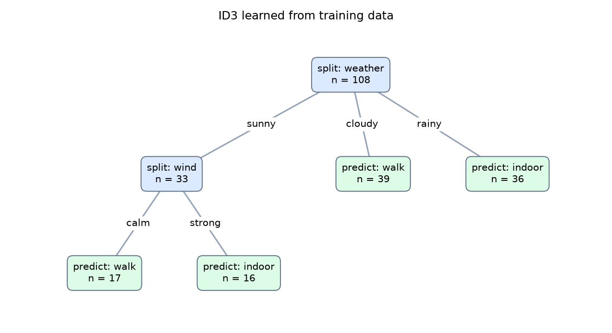

# Categorical decision trees from scratch

A small ID3 classifier built with ordinary Python dictionaries and recursion.
The project explains entropy, information gain, category-based splits, and
prediction through a learned tree. The target has two classes, but a feature
can produce more than two branches.

## Main file and how to run

The **main file is [run_experiment.py](run_experiment.py)**. After installing
the environment as described in the [repository README](../README.md), run
this command from the repository root, with that environment activated:

```bash
python -m decision_trees.run_experiment
```

This one command generates the example data, builds the trees, evaluates
predictions, prints the scores and learned rules, and saves all seven result
files under `decision_trees/results/`. It requires no data download and does
not need an open notebook. Running it again replaces those seven files.

To save a separate run:

```bash
python -m decision_trees.run_experiment --output work/decision-tree-run
```

For the explanation, intermediate tables, and figures, open
[the executed notebook](analysis.ipynb). To reproduce all its outputs, select
the project's `.venv` kernel and **Restart Kernel and Run All Cells**, then
save the notebook. Its final cell exports the same seven result files.

```bash
python -m jupyterlab decision_trees/analysis.ipynb
```

## Read the code in this order

| File | Responsibility |
| --- | --- |
| [tree.py](tree.py) | Entropy, information gain, recursive tree construction, prediction, and text rendering |
| [run_experiment.py](run_experiment.py) | Generate data, split it, fit models, evaluate, and save results |
| [plotting.py](plotting.py) | Draw the tree and confusion matrix |
| [analysis.ipynb](analysis.ipynb) | Walk through the experiment and explain the results |

The core is a sequence of small functions, with no estimator class or global
tree state. Each node is a dictionary containing `feature`, `children`,
`prediction` (the node's majority label), and `samples`. A leaf has
`feature=None`. Branch keys are the actual category values.

## Example data

`make_demo_data()` creates 144 distinct combinations of six categorical
features: weather, wind, temperature, company, day type, and time of day.
The invented label rule is:

```text
If weather is cloudy:                  walk
If weather is sunny and wind is calm:  walk
Otherwise:                            indoor
```

The other four features are deliberately irrelevant to the rule. These rows
and labels are generated by this repository's code; they are not observations
of human behavior or advice about outdoor activities. No external dataset,
downloaded data file, or third-party code is bundled in this module.

Using seed 42, the experiment places 108 rows in training and 36 in testing.
The two sets have no shared rows or duplicate feature combinations. Entropy,
information gain, node majorities, and all splits use training data only.
The full tree, one-split tree (`max_depth=1`), and training-majority baseline
(`max_depth=0`) are specified before evaluation; test scores do not select a
depth.

## Algorithm choices

1. Compute label entropy, then each feature's information gain.
2. Split on the feature with greatest gain; create one branch per observed
   category and remove that feature from the remaining candidates.
3. Recurse until labels are pure, features are exhausted, or the optional
   depth limit is reached. Leaf predictions use the subset's majority class.
4. At prediction time, follow matching branches. If a category was unseen at
   that node during training, return that node's majority class.

Equal gains use input column order. Majority ties use the first label
encountered in the training subset. A zero-gain split is allowed: interactions
such as XOR may only become useful after another split. Removing one feature
at each level guarantees termination even for contradictory labels.

Inputs must be categorical and have no missing values; numeric codes are
treated as categories, not continuous thresholds. This is multiway ID3, not
the binary CART algorithm used by scikit-learn. An unseen-category fallback
is a simple default, not evidence that the model understands a new category.

## Results

| Model | Training accuracy | Test accuracy |
| --- | ---: | ---: |
| Full ID3 | 100.00% | 100.00% |
| One-split tree | 85.19% | 77.78% |
| Training-majority baseline | 51.85% | 44.44% |

The full tree splits first on weather, then on wind for sunny observations.
Its perfect score demonstrates recovery of this simple, noise-free rule.
It is not evidence of performance on real-world data. The one-split tree
cannot express the sunny/wind interaction and underfits this example.
This small demonstration does not measure robustness to noise or distribution
shift, and it does not demonstrate that deeper trees always generalize better.



| Generated file | Contents |
| --- | --- |
| [metrics.csv](results/metrics.csv) | Training and test accuracy for all three models |
| [information_gain.csv](results/information_gain.csv) | Each feature's information gain at the root, using training rows |
| [predictions.csv](results/predictions.csv) | Synthetic test row IDs, actual labels, and predictions |
| [tree.txt](results/tree.txt) | Readable learned rules, sample counts, and fallback labels |
| [tree.png](results/tree.png) | Learned tree diagram |
| [confusion_matrix.png](results/confusion_matrix.png) | Held-out ID3 confusion matrix |
| [metadata.json](results/metadata.json) | Generator rule, seed, split row IDs, model settings, and package versions |

## Tests and references

```bash
python -m pytest tests/test_decision_trees.py
```

The tests check known entropy/gain values, multiway category lookup,
zero-gain XOR, depth limits, unseen categories, and separation of labels
from predictors. They use small generated examples and require no downloads.

- J. R. Quinlan, [Induction of decision trees](https://doi.org/10.1007/BF00116251),
  *Machine Learning* 1, 81–106 (1986).
- [scikit-learn's discussion of tree algorithms](https://scikit-learn.org/stable/modules/tree.html#tree-algorithms-id3-c4-5-c5-0-and-cart),
  including the distinction between ID3 and CART.
