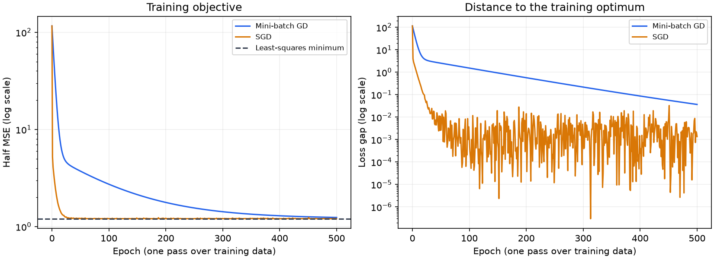

# Linear regression and optimization

Predict sales from TV, radio, and newspaper advertising budgets. This project
compares a NumPy least-squares solution, handwritten
mini-batch gradient descent, handwritten stochastic gradient descent, and
scikit-learn's `LinearRegression`. A training-mean predictor provides a simple
baseline.

Start with [the executed notebook](analysis.ipynb) for formulas, experiments,
plots, and interpretation. Read [algorithms.py](algorithms.py) for the core
implementation. The notebook and CLI call the same experiment code.

## Data

The Advertising dataset contains 200 rows and three predictors. Download it
from the [ISL authors' resource page](https://www.statlearning.com/resources-second-edition):

```bash
python -m linear_regression.data --download
```

Alternatively, import a local copy of the dataset:

```bash
python -m linear_regression.data --from-file /path/to/Advertising.csv
```

Both commands create `data/advertising/Advertising.csv`, which Git ignores.
The loader accepts title-case and lowercase column names and ignores the
row-number column.
Dataset ownership and terms remain with the original source; this repository
provides retrieval instructions rather than redistributing the CSV.
The authors' resource page supplies the download but does not state an
explicit redistribution license for this CSV. The saved notebook shows the
schema, aggregate statistics, and original experiment figures; it does not
include a table of raw dataset rows. Attribution is provided for the data and
does not itself grant redistribution rights.

## Run

From the repository root, with the environment installed as described in the
root README:

```bash
python -m linear_regression.run_experiment
python -m jupyterlab linear_regression/analysis.ipynb
python -m pytest
```

To try a different configuration without replacing the checked-in results:

```bash
python -m linear_regression.run_experiment \
  --learning-rate 0.1 --epochs 500 --batch-size 20 \
  --output work/linear-regression-lr-0.1
```

## Experiment design

- Split the 200 observations into 160 training and 40 test rows with seed 42.
- Fit min-max scaling on training rows only; apply the same transform to test
  rows without clipping values outside the training range.
- Use all three features and an intercept for every fitted model.
- Use learning rate 0.01 and 500 epochs, with batches of 20 for mini-batch GD
  and one example for SGD.
- Compare learning rates 0.001, 0.01, and 0.1 using **training loss only**.
  These exploratory curves do not select a model using test scores.
- Report training half MSE, held-out RMSE, MAE, and R-squared.
- Measure median fit-only time over three repetitions after a warmup, with
  loss-history recording disabled. Loading, scaling, evaluation, and plotting
  are excluded. The main runs still record loss histories for visualization.

The test set is a single, small holdout. This is an optimizer comparison and
learning exercise, not evidence of performance across other populations or a
causal estimate of advertising effectiveness. Iterative solvers are compared
at a fixed epoch budget, not a matched convergence tolerance. One SGD epoch
has 160 updates; one mini-batch epoch has 8 updates.

## Implementation choices

1. The main experiment uses a held-out test set. A separate full-data fit in
   the notebook reports training error only and is excluded from the held-out
   comparison.
2. Least squares uses `numpy.linalg.lstsq` instead of explicitly forming
   `inv(X.T @ X)`. NumPy provides the numerical solver; the two gradient-based
   optimizers implement their updates directly without sklearn estimators.
3. Coefficients are converted back to original units with both slope and
   intercept corrections, with tests that verify predictions are preserved.
4. Loss is recorded at the same epoch boundaries for both iterative methods.
5. Partial final batches and constant-valued features are supported and tested.

For scaled inputs z = (x - minimum) / scale, the original-unit coefficients are
`coef = scaled_coef / scale` and
`intercept = scaled_intercept - minimum @ coef`.

## Results

The notebook calculates and interprets the current run. The CLI saves:

- [metrics.csv](results/metrics.csv): error metrics and measured runtimes.
- [coefficients.csv](results/coefficients.csv): coefficients in original units.
- [metadata.json](results/metadata.json): dataset hash, split, settings, and versions.
- Convergence and learning-rate CSVs, and four figures.



## References

- James, Witten, Hastie, and Tibshirani, *An Introduction to Statistical Learning*,
  [Advertising dataset](https://www.statlearning.com/resources-second-edition).
- [NumPy least-squares solver](https://numpy.org/doc/stable/reference/generated/numpy.linalg.lstsq.html).
- [scikit-learn LinearRegression](https://scikit-learn.org/stable/modules/generated/sklearn.linear_model.LinearRegression.html).
- [scikit-learn guidance on preprocessing and data leakage](https://scikit-learn.org/stable/common_pitfalls.html).
